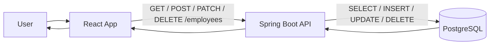
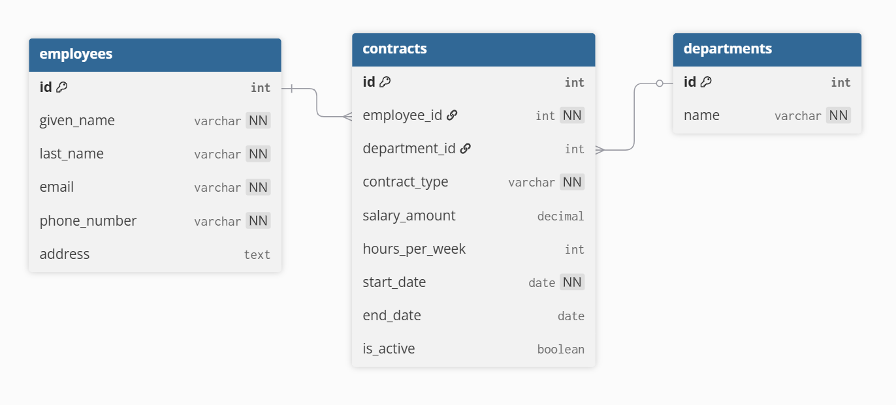

# Employee Creator Spring API + React App

> A production-ready, full-stack HR management system built with Java Spring Boot and React TypeScript

**Live Demo**: [Employee Creator App](https://employeecreator.site/) | **⚡ API**: [Employee Creator API](https://api.employeecreator.site/employees)

## [](https://github.com/carriegale2710/employee-creator/actions/workflows/spring-boot-test.yml) [](https://opensource.org/licenses/MIT)

---

## Project Overview

**Employee Creator** is a full-stack CRUD application for managing employee records and contracts. Built over 4 weeks as a solo project, it demonstrates enterprise-level development practices including comprehensive testing, CI/CD deployment, and scalable architecture.

### Highlights

- ✅ **Full-Stack**: Java Spring Boot API + React TypeScript frontend
- ✅ **Comprehensive Testing**: 40+ automated tests (Unit, Integration, E2E)
- ✅ **Production Deployed**: Render + Neon (free tier); originally AWS EC2 + S3/CloudFront
- ✅ **Enterprise Features**: Employee management, contract tracking, form validation
- ✅ **Modern Stack**: TypeScript, Tailwind CSS, PostgreSQL, GitHub Actions

---

## Key Features

### Who this app is for:

1. **For HR Teams**: Streamline employee onboarding, track contract history, maintain compliance records

2. **For Developers**: Reference implementation showcasing modern full-stack patterns, testing strategies, and deployment practices

3. **For Stakeholders**: Production-ready system with scalable architecture and comprehensive audit trails

#### :man_office_worker: Employee Recordkeeping

- List of all employees at /employees
- Profile view with personal info and contracts
- Add (validated form), edit, and delete (with confirmation)

#### 📄 Contracts Recordkeeping

- View all contracts per employee profile page
- Create contracts linked to an employee
- Delete contracts (WIP)

> **Note:** An employee can have multiple contracts. Contracts are immutable by design: no update.

---

## Tech Stack

A deliberately boring, industry-standard enterprise stack: scalable by design, with robust automated testing and safety checks at every layer.

| Layer      | Technology                                                   | Benefit                             |
| ---------- | ------------------------------------------------------------ | ----------------------------------- |
| DB         | PostgreSQL, JPA                                              | Relational integrity, portable data |
| Backend    | Spring Boot, Java, Maven                                     | Industry-standard, scalable APIs    |
| Frontend   | React, TypeScript, Vite                                      | Fewer runtime bugs, fast builds     |
| Testing    | JUnit, Mockito, REST Assured, H2, Faker (Data seeding)       | Catches regressions before release  |
| Styling    | Tailwind / SCSS                                              | Consistent UI, faster styling       |
| Deployment | Render + Neon (current); AWS EC2, S3 + CloudFront (archived) | Free-tier hosting, zero ops         |
| CI/CD      | GitHub Actions                                               | Automated checks on every push      |
| Monitoring | Log4j2                                                       | Faster debugging in production      |

---

## Core Flow



## Database Design

- **TDD approach**: Tests written before implementation
- **Entity separation**: Employees vs Contracts for better organization
- **One-to-Many relationship**: Supports contract history tracking
- **Immutable contracts**: No update operations by design

**Employees** (1) → **Contracts** (Many)

Each employee can have multiple contracts over time. Contracts are immutable legal documents.



### API Overview

| Method       | Path                       | Purpose                         |
| ------------ | -------------------------- | ------------------------------- |
| GET          | `/employees`               | List employees                  |
| GET          | `/employees/{id}`          | Get one employee                |
| POST         | `/employees`               | Create employee                 |
| PATCH        | `/employees/{id}`          | Update employee                 |
| DELETE       | `/employees/{id}`          | Delete employee                 |
| GET / POST   | `/contracts`               | List / create contracts         |
| GET          | `/contracts/employee/{id}` | List contracts for one employee |
| GET / DELETE | `/contracts/{id}`          | Get / delete a contract         |

---

## Design Decisions

### Backend (the behind-the-scenes part)

- **Contracts stored separately.** One employee can have many contracts over time. Editing a salary or end date touches only that contract.
- **Status is calculated, not stored.** An employee's status comes from their contracts each time it's read, so it can't go stale when a contract ends. Team leaders called this highly useful for HR workflows in their review.
- **Delete is all-or-nothing.** An employee and their contracts are deleted in one transaction, so a failure can't leave orphaned contracts.
- **Saving your own email isn't a conflict.** The duplicate check on update ignores the employee's own record, which fixed a false "email already taken" error.
- **Known limit: loading contracts for status.** Calculating status needs each employee's contracts, which reviewers flagged as a possible slowdown on larger databases. The plan is to load contracts only on single-employee views, then add pagination long term. Neither is built yet.

**Live site safety**

- **Limited database access.** The app reaches only its own data, so damage stays small if something goes wrong.
- **Own website only.** The backend accepts requests only from our front-end and requests are restricted to authorized users if server-side authorization is implemented.
- **Secrets kept out of code.** Passwords and keys are supplied at startup.
- **Server limits.** Memory is capped and crash retries stop after a few attempts.

**Hosting on a budget**

- **Moved to free hosting for the demo.** Moving from AWS to Render and Neon saves over $22/month. The cost is that the free Render service sleeps after 15 minutes without traffic.
- **Uptime monitor over a scheduled GitHub job.** UptimeRobot pings a health check every 5 minutes to keep the service awake. Scheduled workflows can be delayed or dropped, and they're disabled after 60 days of repo inactivity. UptimeRobot also emails on downtime, and needed no code changes.

### Front-end (what people see and click)

- **One form for add and edit.** Less to maintain, consistent for users.
- **Refresh and bookmarks work.** Deep links no longer show an error.

---

## Testing

| Type                  | Tools Used       | Implementation               |
| --------------------- | ---------------- | ---------------------------- |
| Spring Unit Tests     | JUnit + Mockito  | ✅ Service Layers            |
| Spring E2E Tests      | REST Assured, H2 | ✅ 40+ employees / contracts |
| React Component Tests | Vitest           | ⏳ Basic                     |

To run tests, use the following commands:

```bash
./mvnw test      # backend
npm run test     # frontend (if added)

```

---

## Quick Start

### Prerequisites

- Java 21+
- Node.js 18+
- PostgreSQL 14+

### Frontend (React)

```bash
cd front-end
npm install
npm run dev
# App available at: http://localhost:5173
```

### Run Backend (Spring Boot)

```bash
cd employee
./mvnw clean install
./mvnw spring-boot:run
# API available at: http://localhost:8080
```

### Database and environment (backend)

Install PostgreSQL (macOS: `brew install postgresql && brew services start postgresql`; Windows: [download](https://www.postgresql.org/download/windows/)), then:

```sql
CREATE DATABASE your_database_name;
```

Create `employee/.env`:

```env
DB_HOST=localhost
DB_PORT=5432
DB_NAME=your_database_name
SPRING_DATASOURCE_USERNAME=your_user
SPRING_DATASOURCE_PASSWORD=your_password
```

Create `front-end/.env`:

```env
VITE_API_URL=http://localhost:8080
```

Other front-end commands: `npm run build` (production build), `npm run preview` (test the build).

### Request examples

`POST /employees`

```json
{
  "firstName": "Timmy",
  "lastName": "Turner",
  "email": "timmy.turner@example.com",
  "phone": "0400000000",
  "address": "123 Fairy Lane" //opt
}
```

`PATCH /employees/{id}` takes the same fields.

`POST /contracts`

```json
{
  "employeeId": 15,
  "department": "SALES",
  "contractType": "FULL_TIME",
  "salaryAmount": 80000,
  "hoursPerWeek": 38,
  "startDate": "2023-01-10",
  "endDate": null //opt
}
```

### Redeploying (archived AWS setup)

```bash
# backend
./mvnw clean package -DskipTests
scp -i <key.pem> target/employee-creator.jar ubuntu@<EC2_IP>:/home/ubuntu/apps/employee-creator-spring/
ssh -i <key.pem> ubuntu@<EC2_IP> "sudo systemctl restart employee-creator"

# front-end
npm run build
aws s3 sync dist/ s3://<bucket-name> --delete
aws cloudfront create-invalidation --distribution-id <DIST_ID> --paths "/*"
```

Archived AWS details: the backend ran as a `systemd` service behind Nginx with Let's Encrypt TLS and a local PostgreSQL. The front-end ACM certificate had to be requested in `us-east-1` (CloudFront requirement).

---

## Deployment (archived AWS setup)

> Backend API is deployed on AWS EC2. The frontend React app is deployed separately on S3 + CloudFront, and communicates with this backend via HTTPS.

| Layer                 | Service                                     | Domain                     |
| --------------------- | ------------------------------------------- | -------------------------- |
| Frontend (React)      | S3 static site behind CloudFront            | `employeecreator.site`     |
| Backend (Spring Boot) | EC2 (Nginx reverse proxy → systemd service) | `api.employeecreator.site` |
| Database              | PostgreSQL, local to the EC2 instance       | —                          |

> **Note:** Due to AWS costs, the long-term demo deployment has migrated to Render + Neon Postgres (free tier). Config: [render.yaml](render.yaml). The AWS details above are kept for reference and the AWS workflows in `.github/workflows/` are archived (not in use).

---

## Skills and Lessons Learned

I built this employee management app on my own, as a practice run of how real business software gets made. The goal was to work the way a professional team would:

- **Plan for growth = Modularity.** Split the app into clear parts so each can be changed or scaled without disturbing the others. Keep each piece focused on a single responsibility, which makes problems easier to find and fix.
- **Make it genuinely live.** Put it on the internet the way a real product would be, not just on my own laptop.
- **Keep good records.** Write documentation and a running log of changes so anyone can see what changed and why.

### Key Challenges of this project

| **Area**                  | **Challenge**                                         | **What I Did**                                                                   |
| ------------------------- | ----------------------------------------------------- | -------------------------------------------------------------------------------- |
| **Connecting the pieces** | Frontend and backend wouldn't talk once hosted on AWS | Fixed access rules so only the website could reach the backend                   |
| **Testing**               | Writing tests first slowed me down                    | Tried the app by hand first, then wrote tests. Better balance for a solo project |
| **Going live**            | Automated releases were fiddly                        | Changed one small thing at a time and re-tested                                  |
| **Working like a team**   | Simulating team practice solo                         | Stable `main` plus `dev`, one branch per feature, tidied history before merging  |
| **Keeping it organised**  | Documenting a two-part project                        | Split front and back end by purpose; kept the change log updated                 |

---

## Known issues

<!-- Remaining bugs, things that have been left unfixed:

Features that are buggy / flimsy/not functional yet: -->

- [4/11/26] Employee whose only contract has ended shows as `NEW_HIRE` instead of `INACTIVE` ([#55](https://github.com/carriegale2710/employee-creator/issues/55))
- [5/08/25] Contract deletion is not fully implemented yet in front-end (WIP)
- [4/08/25] Pagination needed for employee list to reduce API load times and improve UX
- [4/08/25] Contract form should not have employee ID field - this is a UX issue (risk of human error)
- [25/07/25] React unit tests are still WIP

## Future Goals

Full plan: [docs/roadmap.md](docs/roadmap.md).

1. **Foundations:** fix employee status ([#55](https://github.com/carriegale2710/employee-creator/issues/55)), CORS, profile config and seeding bugs
2. **Performance:** pagination ([#56](https://github.com/carriegale2710/employee-creator/issues/56)), search and filtering, and status computed in SQL, with published before/after query counts
3. **Auth and roles:** session login, admin and viewer roles, salary hidden from viewers, one-click demo logins
4. **UI:** admin-only delete on the list, role title on the employee card, consistent states and spacing

---

## Licensing Details

<!-- What type of license are you releasing this under? -->

MIT License.

---
